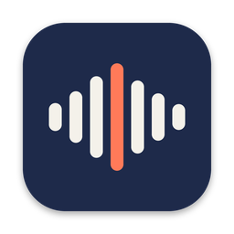
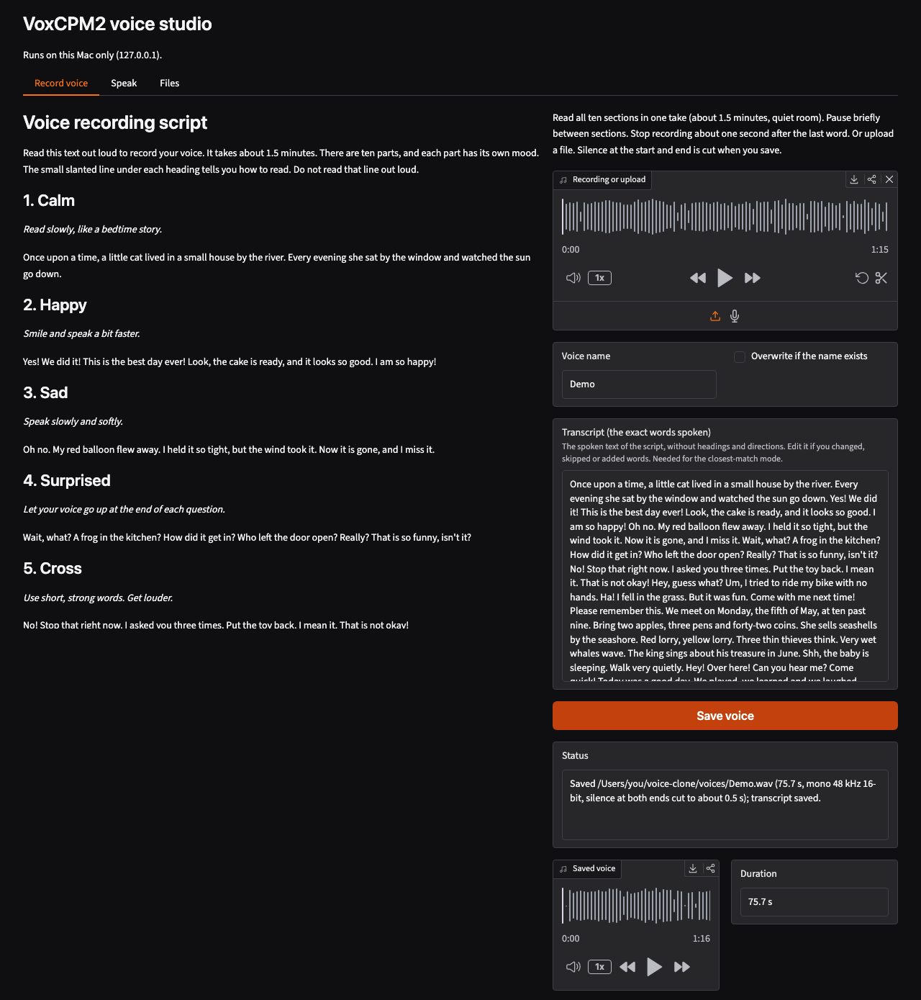
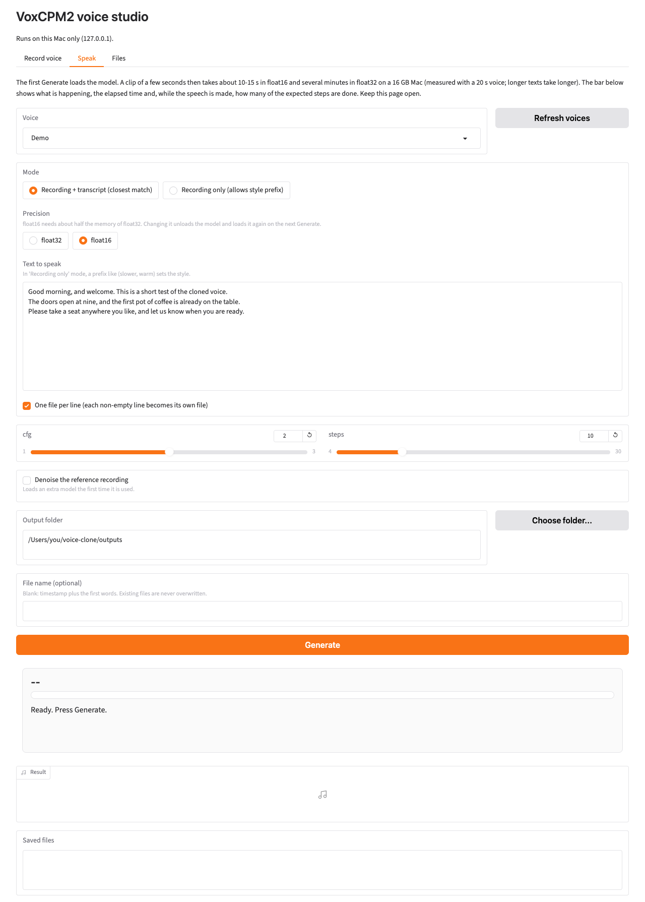
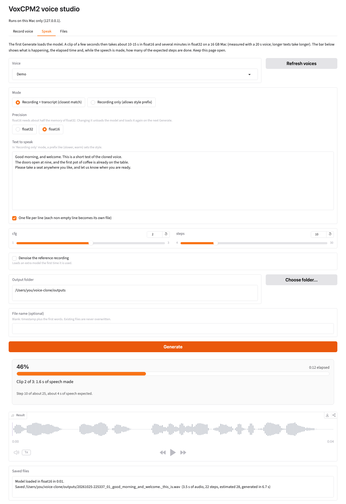
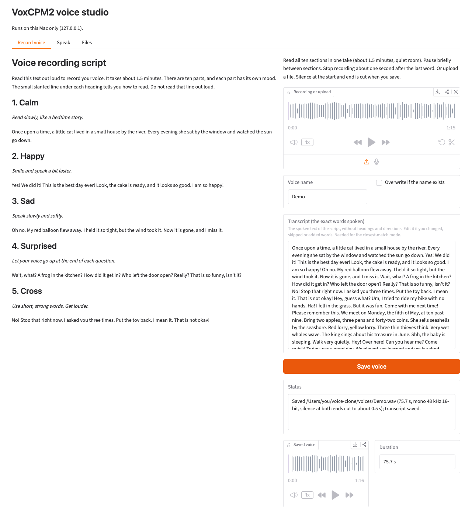
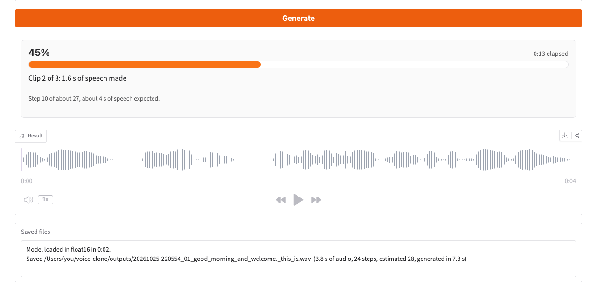
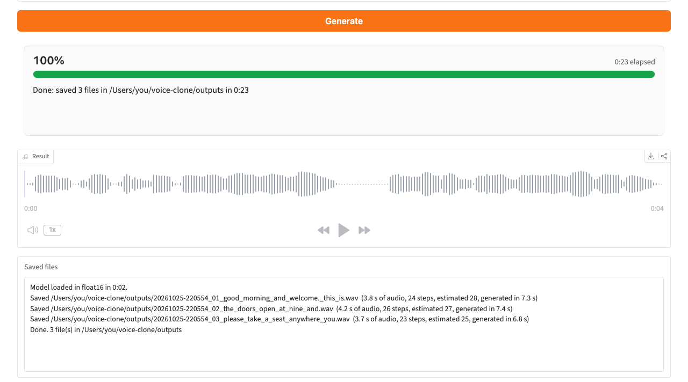
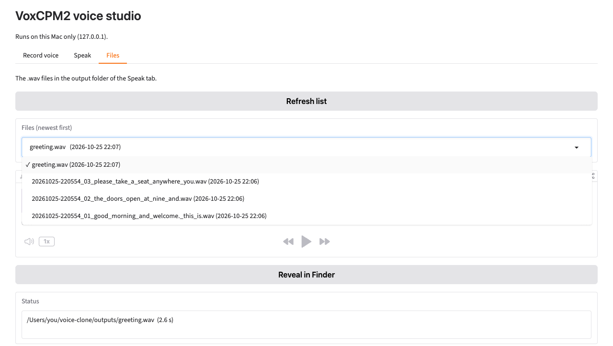

<p align="center">
  
</p>

<h1 align="center">Voice Clone</h1>

<p align="center">
  Clones your voice from a short recording and speaks any text in it, locally on a Mac, with OpenBMB's VoxCPM2.
</p>

<p align="center">
  
  
  
  <a href="https://huggingface.co/openbmb/VoxCPM2"></a>
  <a href="LICENSE"></a>
</p>

<p align="center">
  
</p>

<table>
  <tr>
    <th align="center">Speak</th>
    <th align="center">Generating</th>
  </tr>
  <tr>
    <td></td>
    <td></td>
  </tr>
</table>

The screenshots come from a demo copy of the app with a stand-in model that speaks with the macOS `say` command instead of VoxCPM2. The voice "Demo" was also made with `say`. The voice, the texts and the sounds in them are made up, the times are not measurements, and the folder paths are shortened to `/Users/you/voice-clone`.

## Features

- Records a voice in one take, about 1.5 minutes of reading a script with ten speaking styles, or takes an uploaded audio file. The recording and its transcript are saved as a voice under one name.
- Speaks typed text in a saved voice with VoxCPM2, OpenBMB's open text-to-speech model (Apache-2.0, Hugging Face id `openbmb/VoxCPM2`). Two modes: "Recording + transcript (closest match)", and "Recording only (allows style prefix)", where the text can start with a style such as `(slower, warm)`.
- One file per line: each non-empty line becomes its own 48 kHz WAV clip. Existing files are never overwritten.
- Settings for the precision (float16 by default, which needs about half the memory of float32), cfg, steps, optional denoising of the reference recording, the output folder and the file name.
- One progress bar for the whole run: the percentage, the elapsed time, what is happening in plain words, and the steps of the clip being made.
- A Files tab that lists the generated clips, newest first, and plays them or shows them in Finder.
- A web interface with three tabs (Record voice, Speak, Files) at http://127.0.0.1:7860, and a Mac app, "Voice Clone.app", that shows it in a window of its own or in your default browser.
- An installer, `install.sh`, that sets up the Python environment, downloads the models and installs the Mac app.
- Command-line scripts: `record.sh` records a voice, `clone.py` speaks text, `demo.py` checks the install.
- Everything runs on this Mac. Recordings, texts and generated audio never leave it. The only network use is downloading and checking software and models. See [Privacy](#privacy).

## Requirements

- A Mac with Apple Silicon. `install.sh` stops on any other machine, and on a terminal that runs under Rosetta.
- macOS 12 or newer for the desktop app. The browser app declares macOS 11 as its minimum. The author's Mac runs macOS 26.6.2.
- Memory: the numbers in [Memory and speed](#memory-and-speed) were measured on a 16 GB Mac. Other sizes were not measured.
- Disk space: VoxCPM2 is 4.6 GiB, the denoiser 18.2 MiB, and the Python environment `.venv` 1.6 GiB (measured with `du` on the author's Mac). The installer stops if the free space is smaller than the model download plus 1 GiB.
- Network access for the install: Homebrew, PyPI, Hugging Face and ModelScope.
- ffmpeg and uv. The installer installs them with Homebrew if they are missing. It does not install Homebrew itself.
- The Command Line Tools (`xcode-select --install`) or Xcode, only for the desktop app. Either provides `swiftc` and the macOS SDK; `make-app.sh` uses the one `xcode-select -p` points to. The desktop app compiles with Swift 5.8.1 (Command Line Tools, macOS SDK 13.3) and Swift 6.4 (Xcode 27.1, macOS SDK 27.0).
- Python 3.11. The installer asks uv to create the environment, so you do not install Python yourself.
- A microphone, or audio files to upload.

## Installation

```
git clone https://github.com/SaschaKubisch/voice-clone.git
cd voice-clone
bash install.sh
```

The installer sets up everything. Afterwards Generate needs no further download. Run it again at any time: it skips what is already done.

Options:

| Option | Result |
| --- | --- |
| `--browser` | Install the browser app instead of the desktop app (see [The Mac app](#the-mac-app)). |
| `--no-app` | Skip the Mac app. Start the interface with `start.command` or `.venv/bin/python app.py`. |
| `--no-models` | Skip the model downloads. The first Generate downloads VoxCPM2 instead. |
| `-h`, `--help` | Print the usage. |

What it does, in this order:

1. **Checks**: macOS, Apple Silicon, this folder. For the Mac app it also checks that Voice Clone is not running, and, for the desktop app, that `swiftc` and the macOS SDK exist. It checks first so that a failure does not come after the downloads.
2. **uv and ffmpeg**: installed with Homebrew if one is missing. Without Homebrew it stops and prints the link (https://brew.sh) and the commands to run.
3. **Python environment**: `.venv` in this folder, Python 3.11, with the packages of `requirements.txt`. An existing `.venv` with Python 3.11 is kept. Any other `.venv` is recreated.
4. **Models**: VoxCPM2 and the denoiser, downloaded into the standard caches (see [Models and where they are stored](#models-and-where-they-are-stored)). They are downloaded, not loaded into memory. Files that are already complete are not downloaded again.
5. **Mac app**: `/Applications/Voice Clone.app`, built by `make-app.sh --install`.

If a step fails, the installer prints `install.sh: step N (name) failed: ...` and the reason. Fix the cause and run it again. Finished downloads are kept.

To update, run `git pull` and then `bash install.sh` again. Quit the Mac app first.

### Manual setup

Needs [uv](https://docs.astral.sh/uv/) and ffmpeg (`brew install ffmpeg`).

```
uv venv --python 3.11 .venv
uv pip install --python .venv/bin/python -r requirements.txt
```

`requirements.txt` pins the versions the scripts were tested with (voxcpm 2.0.3, torch 2.14.1, gradio 6.30.0). If the models are not downloaded, the first Generate downloads the VoxCPM2 weights into `~/.cache/huggingface`.

## Usage

### Terms

- **VoxCPM2**: the text-to-speech model. It makes speech from text and copies a voice from a recording.
- **Reference recording**: the recording of the voice to copy. The app saves it as `voices/<name>.wav`.
- **Transcript**: the exact words spoken in the reference recording, as text. The app saves it as `voices/<name>.txt`.
- **Voice**: a reference recording and its transcript, kept under one name in `voices/`.
- **Clip**: one generated audio file.
- **Mode**: how the model gets the voice. "Recording + transcript" passes the recording and its words. "Recording only" passes the recording alone.
- **cfg**: the classifier-free guidance scale, a number from 1.0 to 3.0 in the app (default 2.0). It sets how strongly the model is pushed toward the voice and the text.
- **steps**: the number of diffusion sampling steps the model takes for each piece of speech, from 4 to 30 in the app (default 10). The steps of the progress bar are something else (see [The progress bar](#the-progress-bar)).
- **Precision**: the number format of the model, float16 or float32. float16 needs about half the memory.
- **Denoise**: an option that removes background noise from the reference recording, with a small second model, before the model uses it.
- **MPS**: the GPU backend of PyTorch on Apple Silicon. The web interface always uses it.
- **Server**: the program `app.py`. It serves the web interface on this Mac at http://127.0.0.1:7860.

### Starting the app

With the Mac app, open Voice Clone from Launchpad or Spotlight (see [The Mac app](#the-mac-app)). Without it:

- Double-click `start.command` in Finder. It starts the server in a Terminal window and opens the browser. When the server stops, the window asks you to press Return.
- Or run `.venv/bin/python app.py` in this folder. It also opens the browser.

The page, titled "VoxCPM2 voice studio", is at http://127.0.0.1:7860. The server listens on this machine only. Press Ctrl-C in the Terminal window to stop it.

### Recording a voice

Open the Record voice tab. It shows `voice-script.md` on the left and the recording controls on the right.



1. Read `voice-script.md`. It has ten sections, one mood each: calm, happy, sad, surprised, cross, friendly, clear, tricky sounds, quiet then loud, calm and kind. The words are easy. All ten sections are 234 spoken words, about 1.5 minutes. The italic line under each heading is a reading direction. It is not read aloud.
2. Press Record and read all ten sections in one take. Or use the small upload icon under the box and choose an audio file. The microphone icon next to it switches back.
3. Enter a **Voice name**. The box starts with `me`. Letters, digits, dot, dash and underscore are kept, every other character becomes `_`, and the name is cut to 60 characters.
4. Check the **Transcript**. It is filled with the spoken text only. The title, the intro, the headings and the reading directions are left out. The transcript must match the words you say. Edit it if you changed, skipped or added words. Leave it empty if you do not have one. Then only the "Recording only" mode works for this voice.
5. Press **Save voice**. The status line shows the file, its length and the changes made. The saved voice plays in the box below, and it is selected in the Speak tab.

Tips for the recording:

- Record in a quiet room, in one take, all ten sections.
- Pause briefly between sections.
- Stop recording about one second after the last word.
- Read the way each direction says. The sections cover different speaking styles on purpose.

What saving does:

- The recording becomes a mono 48 kHz 16-bit WAV.
- Silence at the start and the end is cut to at most about 0.5 s (threshold -50 dB). Pauses inside the speech are not touched. If the room noise is louder than -50 dB, the ends are not cut.
- If less than 1 s is left after the cut, nothing is saved and the app says "No speech found". Check the microphone.
- If the name exists, nothing is saved until you tick **Overwrite if the name exists**. A save that fails keeps the old voice.
- The saved duration is shown next to the player.

A long reference makes every generation slower, because the model processes the reference again on each call. `voxcpm_patch.py` keeps the memory use of a long reference down (see [Memory and speed](#memory-and-speed)).

The recording step also exists on the command line (`record.sh`, see [Command line](#command-line)).

### Generating speech

Open the Speak tab (the left screenshot at the top shows it). Choose a voice, type text and press Generate. The first Generate loads the model, which takes longer than the later ones. The model stays loaded until the app stops.

| Setting | What it does |
| --- | --- |
| **Voice** | The saved voice to copy. The list is read when the app starts. Saving a voice updates it. Press **Refresh voices** after you copy files into `voices/` by hand. |
| **Mode** | "Recording + transcript (closest match)" passes the recording with its exact words. It gives the closest match of voice, rhythm and pronunciation. The voice needs a transcript, and the transcript must match what was said. "Recording only (allows style prefix)" passes the recording alone. Here the text can start with a style instruction in parentheses, for example `(slower, warm)Hello`. In the first mode a text that starts with `(` is refused. |
| **Precision** | float16 (default) or float32. float16 needs about half the memory. Changing it frees the loaded model and loads it again in the new precision on the next Generate. See [Memory and speed](#memory-and-speed). |
| **Text to speak** | What the voice says. Without "One file per line", line breaks are joined with spaces into one clip. The app does not run VoxCPM's text normalization. |
| **One file per line** | Each non-empty line becomes its own clip and its own file. The progress bar then says "Clip 2 of 3". |
| **cfg** | The guidance scale, 1.0 to 3.0 in steps of 0.1. Default 2.0. |
| **steps** | The diffusion sampling steps, 4 to 30. Default 10. |
| **Denoise the reference recording** | Removes background noise from the recording before the model uses it. The first use loads an extra model (18.2 MiB, see [Models and where they are stored](#models-and-where-they-are-stored)). Every clip then cleans and reads the recording again, so each clip takes longer. |
| **Output folder** | Where the files go. The default is `outputs` in this folder. A path that starts with `~` is expanded. A relative path counts from this folder. The folder is created if it does not exist. **Choose folder...** opens the macOS folder dialog. |
| **File name (optional)** | Blank: the name is made from a timestamp and the first words of the line. Typed: the name you give, with or without `.wav`. |

Defaults 2.0 and 10 are the defaults of VoxCPM. The ranges are the ranges that `clone.py` recommends.

#### Output files

Files are WAV at 48 kHz. Existing files are never overwritten.

| Case | File name |
| --- | --- |
| Blank name, one clip | `20261025-220554_good_morning_and_welcome._this_is.wav` |
| Blank name, several lines | `20261025-220554_01_good_morning_and_welcome._this_is.wav`, then `_02_`, and so on |
| Name `greeting`, one clip | `greeting.wav` |
| Name `greeting`, several lines | `greeting_01.wav`, `greeting_02.wav` |
| The file exists already | `_2`, `_3` is added: `greeting_2.wav` |

The automatic name is the time, the line number when there are several lines, and the first six words of the line (cut to 40 characters, lower case, other characters replaced by `_`). A style prefix in parentheses is left out of the name. Names you type are cleaned the same way as voice names.

#### What to change for which effect

This project has not measured how cfg and steps change the sound. The advice below follows from the settings and from the code of voxcpm. Change one setting at a time and generate the same text again to compare. Results can differ from run to run, because the app sets no random seed. For style control, the VoxCPM2 model card says results vary and recommends generating 1 to 3 times.

| You want | Change |
| --- | --- |
| A closer copy of the voice | Use "Recording + transcript", and check that the transcript matches the recording word for word. Use a clean recording of the full script. |
| A style, such as slower or warmer | Use "Recording only" and start the text with `(slower, warm)`. |
| Less background noise in the result | Tick Denoise, or record again in a quieter room. |
| The voice followed more or less strictly | Raise or lower cfg inside 1.0 to 3.0. cfg 1.0 is the plain prediction. A higher value pushes the result further toward the voice and the text. |
| A faster result | Lower steps. Each model step runs the diffusion decoder once per sampling step, so more steps take longer. Also keep Denoise off and use float16 and a shorter reference. |
| A more careful result | Raise steps up to 30. The cost is time. Whether it sounds better was not measured here. |
| A word or number read wrongly | Write it out in words, for example "forty-two". |
| A long text | Put it on several lines and use "One file per line". The model card warns about occasional instability with very long inputs. |
| Less memory | Keep float16. |

### The progress bar

One bar sits under the Generate button. It shows the percentage of the whole run, the elapsed time, what is happening now in plain words, and a second line with details. The page changes at most twice a second, and only when something changed. Gradio's own progress overlay is off for this event.





What the bar shows:

| Bar text | What is happening |
| --- | --- |
| Loading the model (first time only) | VoxCPM2 loads into memory. The second line names the precision and the expected time (about 1 minute for float16, 2-4 minutes for float32). The bar is a faded striped bar without a percentage. |
| Loading the model again, because the precision changed | The old model is freed and the new one loads. |
| Loading the denoiser (first time only) | Only with Denoise ticked. |
| Clip 2 of 3: Cleaning up the voice recording (denoiser) | Only with Denoise ticked. |
| Reading the voice recording | The model reads the reference recording. |
| Preparing the text | The model prepares the text. |
| Clip 2 of 3: 1.6 s of speech made | The model makes speech. The second line says "Step 10 of about 27, about 4 s of speech expected." |
| Checking the take | The model checks the length of the take. |
| Turning the speech into sound | The audio is decoded. |
| Saving the clip | The file is written. |
| Saved clip 2 of 3: name (3.8 s of speech) | Between two clips. |
| Done: saved 3 files in the output folder in 0:23 | The run is finished. The bar is green and shows 100%. |
| Stopped: the error message | The run failed. The bar is red. Nothing more is made. Press Generate to try again. |

The text "Clip 2 of 3:" appears only when the run has several clips. "(try 2)" and "The first take was too long for the text, so it is made again" mean that VoxCPM repeated the take, which it does up to three times when a take is far too long for the text. "Longer than first estimated" means the clip ran past its estimate.

How the bar is worked out:

- The model makes speech in steps. One step makes 0.16 s of audio (6.25 steps per second). These are not the steps of the steps slider. `voxcpm_patch.py` counts the steps of the generation loop of voxcpm without changing it, so the audio is the same. The bar of a clip moves with the steps.
- Reading the voice, preparing the text, turning the speech into sound, saving and loading the model have no step count. The bar stands still or shows a striped bar there, and the second line says so.
- The number of steps of a clip is estimated from the text before it starts: characters times 6.25 divided by the characters per second of the chosen voice (its transcript length over its recording length, limited to 8-20; 15 without a transcript). After each clip the measured steps per character replace the estimate for that voice. When a clip runs past its estimate, the estimate grows and the bar keeps rising, but it shows 100% only after the last clip is saved.
- Several clips ("one file per line"): the bar is (finished clips + part of the current clip) divided by the number of clips.

`tests/test_progress_ui.py` checks the bar with a stand-in model on port 7861 and never loads the real model. `tests/test_progress_hook.py` checks the step counting without loading the model.

Below the bar, the **Result** player plays the last clip. The **Saved files** box lists one line per clip: the path, the seconds of audio, the steps made, the estimate and the generation time.

### The Files tab

The Files tab lists the `.wav` files in the output folder of the Speak tab, newest first, with the date of each file.



- The list refreshes when you open the tab. **Refresh list** reads the folder again.
- Choosing a file loads it into the **Player** and shows its path and length in the status line.
- **Reveal in Finder** selects the chosen file in a Finder window.
- If the output folder does not exist yet, the status line says so.

### Command line

Run these from this folder. The scripts use the `.venv` that the installer made.

```
bash record.sh                                           # records you reading voice-script.md: 100 s, writes voices/me.wav, cuts silence at both ends
bash record.sh voices/myvoice.wav 150                    # another file name and length in seconds
.venv/bin/python -c "from app import script_transcript as s; print(s('voice-script.md'))" > voices/myvoice.txt
.venv/bin/python clone.py --ref voices/myvoice.wav --ref-text-file voices/myvoice.txt --text "Hello." --out outputs/hello.wav
.venv/bin/python clone.py --ref voices/myvoice.wav            # type one line per clip; an empty line ends
.venv/bin/python clone.py --ref voices/myvoice.wav --dtype float32 --text "Hello."   # float32 instead of the default float16
.venv/bin/python demo.py mps                                  # speech without cloning, as an install check
```

#### record.sh

`bash record.sh [OUTPUT_PATH] [SECONDS]` counts down from 3, then records the microphone for the given number of seconds, or until Ctrl-C, and keeps what was recorded. The default is `voices/me.wav` and 100 s. It cuts the silence at both ends the way the app does. It writes only the WAV, no transcript.

The script records from the device named `MacBook Air Microphone` and uses `/opt/homebrew/bin/ffmpeg`. For another microphone, change `DEVICE` at the top of `record.sh`. To list the device names:

```
ffmpeg -f avfoundation -list_devices true -i ""
```

The command ends with an error line. The list above it is the result.

`voices/myvoice.txt` is the transcript file. The app writes the same kind of file next to the WAV when you save a voice. After `record.sh`, the `python -c` line above writes it from `voice-script.md`. Without a transcript file, use `clone.py --ref` alone (reference only).

#### clone.py

`clone.py` loads the model once, then makes one clip per text. Run `.venv/bin/python clone.py --help` for the full text.

| Option | Meaning |
| --- | --- |
| `--ref PATH` | The reference recording. Required. |
| `--ref-text TEXT`, `--ref-text-file PATH` | The exact words spoken in the recording. With either one, the mode is reference + continuation (highest fidelity), the same as "Recording + transcript" in the app. Without them, only the recording is used. Use one of the two, not both. |
| `--text TEXT` | One text, one clip. Written to `--out`, or to `outputs/output_001.wav`. |
| `--text-file PATH` | A file with one text per non-empty line, one clip each: `output_001.wav`, `output_002.wav` and so on, in `--out-dir`. A line that fails is reported and the next one runs. |
| no text option | Type one sentence per line at the prompt. An empty line or Ctrl-D ends. Files are `output_NNN.wav` and take the next free number. |
| `--out PATH` | The output file for `--text`. |
| `--out-dir DIR` | The folder for the other cases. Default: `outputs/` next to the script. |
| `--device DEVICE` | `mps` (default), `cpu`, `cuda` or `auto`. |
| `--dtype float16\|float32` | The precision on MPS. Default float16. |
| `--cfg`, `--steps` | Defaults 2.0 and 10. The script accepts 0.1 to 10.0 and 1 to 100, and recommends 1.0 to 3.0 and 4 to 30. |
| `--denoise` | Loads the denoiser and cleans the reference recording. |

A style prefix such as `(slower, warm)Hello` is meant for the mode without a transcript. The app refuses it in the other mode. `clone.py` does not check it.

With `--text` and `--text-file`, an existing `output_NNN.wav` or `--out` file is overwritten. The app never does that.

#### demo.py

`demo.py [DEVICE] [OUTPUT_PATH]` speaks one fixed sentence without cloning and writes `demo.wav` (or the path you give) in the current folder. It prints the device, the generation time and the length of the audio. It loads the model through voxcpm directly, not through `voxcpm_patch.py`, so on Apple Silicon it runs in float32. That is the larger of the two precisions (see [Memory and speed](#memory-and-speed)). Quit the Mac app before you run it.

## The Mac app

`make-app.sh` builds "Voice Clone.app" in two modes. Both install as `/Applications/Voice Clone.app` (bundle id `local.voiceclone`), so installing one replaces the other.

| | Desktop app (default) | Browser app |
| --- | --- | --- |
| What it is | A window of its own, with its own Dock icon and menu. A small Swift app (`macapp/desktop/`) that shows the web interface in a WebKit view. | A launcher that opens the web interface in your default browser. An AppleScript applet built with `osacompile`. |
| Needs | The Command Line Tools or Xcode for `swiftc`, and macOS 12 or newer. No Xcode project, no new dependency. | Nothing extra. |
| Install | `bash install.sh` or `bash make-app.sh --install` | `bash install.sh --browser` or `bash make-app.sh --install --browser` |

The icon, shown at the top of this file, is a sound wave on a dark blue rounded square. `macapp/make_icon.py` draws it, and `docs/icon.png` is its render at 256 pixels.

### Install and switch

```
bash make-app.sh --install             # desktop app: builds macapp/build/Voice Clone.app, copies it to /Applications, registers it with Launch Services, deletes the build copy
bash make-app.sh --install --browser   # browser app, the same steps
bash make-app.sh                       # builds the desktop app only and keeps it in macapp/build (add --browser for the browser app)
bash make-app.sh --repo <folder>       # the app starts the server from <folder> (default: the folder of the script)
```

To switch from one mode to the other, quit the app and run the install command of the other mode. `--install` refuses while either mode is running.

Launch Services, the part of macOS behind Launchpad, Spotlight and "Open With", registers every new `.app` folder by itself, 10 to 50 seconds after it appears. It did this for the build copy in `macapp/build` too, and the build copy and the installed copy have the same bundle id, so they showed up as two "Voice Clone". Naming the folder `build.noindex` did not prevent it. So `make-app.sh --install` deletes the build copy after it has installed and registered `/Applications/Voice Clone.app`, then unregisters the deleted path (`lsregister -u`). Afterwards Launchpad and Spotlight list one Voice Clone.

`bash make-app.sh` without `--install` keeps the build in `macapp/build`, because `macapp/test-desktop.sh` needs it. Launch Services can list that build copy as a second Voice Clone while it exists. The next `bash make-app.sh --install` removes it.

Both modes are signed ad hoc, which means with no certificate. This is enough to run on the Mac that built them. They are not notarized, and macOS would block them if they were downloaded from elsewhere. Build the app on each Mac. There is no hardened runtime and no sandbox.

To remove the app, quit it and move `/Applications/Voice Clone.app` to the Trash.

### Start, quit and crash

Both modes work the same way underneath (`macapp/voiceclone.sh`):

- **Start**: if http://127.0.0.1:7860 already answers, the app uses that server. Otherwise it starts `.venv/bin/python app.py` in the background and waits up to 90 s. The first start can take a minute.
- **Quit** (Cmd-Q) stops the server this app started: SIGTERM, then SIGKILL after 10 s. A server the app did not start, such as one from `start.command`, keeps running.
- **Force quit or crash**: the server keeps running. The next start finds the running server and uses it, but the app does not own it, so Quit does not stop it. Stop it with `pkill -f '.venv/bin/python app.py'`.
- **Folder**: the app points to this repo folder, fixed when `make-app.sh` runs. If the folder moves, run `bash make-app.sh --install` again there. If `.venv` is missing, the app shows the setup commands.

### Log file

The server output of a server started by the app goes to `~/Library/Logs/VoiceClone/app.log`. When the app starts a server and the file is larger than 5 MiB, it is renamed to `app.log.1` and a new one starts. The app names this file in its message when the server does not start. To read the end of it:

```
tail -n 40 ~/Library/Logs/VoiceClone/app.log
```

A server started with `start.command` or `.venv/bin/python app.py` prints into its Terminal window instead.

### Microphone permission

The first time you record in the Record voice tab, macOS asks to allow the microphone for Voice Clone. The text of the question is "Voice Clone records your voice in the Record voice tab. The recording stays on this Mac." Allow it. The window grants the microphone only to the page of this server.

- If you chose Don't Allow, switch it on in System Settings, Privacy & Security, Microphone.
- macOS may ask again after you install a new build, because every build has a new ad hoc signature.
- In the browser app, and with `start.command`, the microphone permission of your browser for 127.0.0.1 applies instead. Allow it there.
- You can always upload a recording instead of recording (see [Recording a voice](#recording-a-voice)).

### Desktop app

- **Window**: one window titled "Voice Clone", 1200 x 900 or smaller to fit the screen. It shows "Starting Voice Clone..." until the server answers, then the web interface. If the server does not answer within 90 s, an alert names the log file and the app stops the server it started. Cmd-R then tries again. The app keeps no state between runs: no window position, no cookies.
- **Quit**: Cmd-Q, or closing the window (Cmd-W), quits the app and stops the server it started.
- **Menu**: Voice Clone (About, Hide, Quit), File (Close), Edit (Undo, Redo, Cut, Copy, Paste, Select All), View (Reload with Cmd-R, Enter Full Screen), Window.
- **Downloads**: the download button of an audio player saves the file into `~/Downloads` (a name that exists gets " 2", " 3") and shows it in Finder. macOS can ask to allow access to the Downloads folder.
- **Uploads**: the upload buttons open the standard file dialog.
- **Links**: a link that wants a new window, or points outside 127.0.0.1, opens in the default browser.

### Browser app

- **Open** it from Launchpad. If the server already answers, the app only opens the page in the browser. Otherwise it starts the server, waits, then opens the browser once. Clicking the app again in the Dock or Launchpad opens the page again.
- **Quit** (Cmd-Q, or Dock, Quit) stops the server this app started. Closing the browser tab does not.
- If the server does not start, a dialog names the log file and has an Open Log button.

## Models and where they are stored

| Model | What it is for | Size | Where | Downloaded |
| --- | --- | --- | --- | --- |
| VoxCPM2, Hugging Face id `openbmb/VoxCPM2` | Makes the speech | 4.6 GiB (about 5 GB) | `~/.cache/huggingface/hub` | By `install.sh` step 4. With `--no-models`, by the first Generate. |
| ZipEnhancer denoiser, ModelScope id `iic/speech_zipenhancer_ans_multiloss_16k_base` | Removes noise from the reference recording | 18.2 MiB | `~/.cache/modelscope/models` | By `install.sh` step 4. Used only with Denoise ticked. |
| SenseVoiceSmall, ModelScope | Speech recognition for one test | about 0.9 GB | `~/.cache/modelscope/models` | Only by `tests/test_fp16_audio.py`, on its first run. The installer does not install it. |

The cache folders change if you set `HF_HOME` or `MODELSCOPE_CACHE`. The caches are shared with every other program that uses the same models. The sizes were measured on the author's Mac.

The installer downloads the models but does not load them. VoxCPM2 loads into memory at the first Generate, not when the app starts.

## Memory and speed

Precision. The model runs in float16 by default (`--dtype` in `clone.py`, Precision in the Speak tab). voxcpm 2.0.3 would use float32 on Apple Silicon, because bfloat16 gave noise there. `voxcpm_patch.py` selects float16 through the variable voxcpm reads for this (`VOXCPM_MPS_DTYPE`). The language models, the diffusion decoder, the projections and the caches run in float16. The audio VAE stays float32.

Measured on the author's 16 GB Mac with other applications open, with a 20 s reference and a sentence of about 4 s:

| | float16 (default) | float32 |
| --- | --- | --- |
| Load time | 27-34 s (four runs) | 155 s (one run) |
| GPU memory after loading (`torch.mps.driver_allocated_memory`) | 5.6 GiB | 9.6 GiB |
| GPU memory after generating | 6.8 GiB | 11.8 GiB |
| First clip | 14-16 s (four runs) | 202 s (one run). macOS swap use rose from 6.9 to 9.9 GB during the run. |
| A later clip with the same voice | 9 s (one run) | not measured |

- An ASR model (SenseVoiceSmall) transcribed both outputs as "the quick brown fox jumps over the lazy dog near the riverbank".
- Loading float16 still peaks at about 10 GiB (process footprint), because voxcpm builds the model in float32 on the CPU first and then casts it. The reason is read from its source. The peak itself was measured.
- `tests/test_fp16_audio.py` checks that the float16 output is speech.
- The precision setting only applies on MPS.
- Close other applications before generating. Use `--device cpu` (command line) if MPS reports an error. The speed on the CPU was not measured.
- A reference longer than 20 seconds, such as the full script, is encoded in 20-second pieces to fit in memory, and once per app run instead of on every generation (`voxcpm_patch.py`, applied by `app.py` and `clone.py`). `tests/test_chunked_encode.py` checks that the pieces give the same result as encoding the whole recording.
- With Denoise on, the cleaned copy of the reference is a new temporary file for every clip, so the stored result cannot be reused. Each clip then reads the reference again.

## Privacy

Voice recordings are sensitive. A recording of a voice and its transcript are enough to clone that voice, and that is what this tool does. Treat the files in `voices/` the way you treat anything that can be used to speak as you. Clone only voices you have permission to clone. The VoxCPM2 model card says: "Strictly forbidden to use for impersonation, fraud, or disinformation. AI-generated content should be clearly labeled."

What stays on this Mac:

- The server listens on 127.0.0.1 only, and Gradio's public share link is off (`share=False`). Gradio's analytics are off.
- Recordings, transcripts and generated audio are files on this Mac: `voices/`, `outputs/`, or the folder you choose. No code in the project sends audio or text to another computer.
- When the page was loaded in a headless browser against the demo copy, the only address it contacted was 127.0.0.1.

What uses the network:

- The install: Homebrew, PyPI, Hugging Face and ModelScope.
- Loading the model. voxcpm asks the Hugging Face Hub for the model files (`snapshot_download`), so each load can check whether the cached files are current. That request carries no audio and no text. Hugging Face documents the variable `HF_HUB_OFFLINE=1` to forbid it. This project has not tested it. The denoiser loads through ModelScope the first time Denoise is used. Whether ModelScope then contacts its hub was not checked.

What is kept besides the files you save:

- Temporary copies of your recordings and clips. The audio players use copies in a folder named `voice-ui-...` in the temporary folder of macOS. Gradio keeps copies of uploaded and generated audio in `gradio` in the same place. The app does not delete them when it stops. To find the folder, run `echo $TMPDIR`. To remove the copies, quit the app and delete `gradio` and the `voice-ui-...` folders there.

What is kept out of git (`.gitignore`): `voices/*`, `outputs/`, every `*.wav`, `.venv/`, `__pycache__/`, `*.log`, `.DS_Store` and `macapp/build/`. Voice recordings, generated audio and the Python environment never go into the repository. This does not cover an output folder you pick inside another repository, and it does not stop `git add -f`.

## Troubleshooting

| Problem | Cause and fix |
| --- | --- |
| `Cannot find empty port in range: 7860-7860` | Another program uses port 7860, often an earlier Voice Clone server. The port is fixed in `app.py`. Find the program with `lsof -nP -iTCP:7860 -sTCP:LISTEN`. If it is a Voice Clone server, quit the app, or stop it with `pkill -f '.venv/bin/python app.py'`. If another program answers on 7860, the Mac app opens that program's page. |
| The Mac app does not start, or says "Voice Clone did not start" | Read the log file: `tail -n 40 ~/Library/Logs/VoiceClone/app.log`. In the desktop app, Cmd-R tries again. The messages "The server did not answer within 90 seconds. It was stopped." and "The server stopped before it was ready." mean the server did not come up. The log says why. |
| "The Python environment is missing in ..." | `.venv` is missing. Run `bash install.sh`. Or run the two commands under [Manual setup](#manual-setup). The dialog has a Copy Commands button. |
| "The Voice Clone folder was not found" | The folder moved or was deleted. The app points to the old place. Run `bash make-app.sh --install` in the folder where it is now. Quit the app first. |
| Two Voice Clone entries in Launchpad | Launch Services registered the build copy in `macapp/build`, which `bash make-app.sh` (without `--install`) leaves there. Quit the app and run `bash make-app.sh --install` again. It deletes the build copy and unregisters it. |
| The microphone does not work | In System Settings, Privacy & Security, Microphone, switch Voice Clone on. In a browser, allow the microphone for 127.0.0.1. Or upload a recording. See [Microphone permission](#microphone-permission). |
| `record.sh` prints "Recording ended early" and "error: nothing was recorded" | The device name in the script does not exist on your Mac (see [record.sh](#recordsh)), or macOS has not allowed the microphone for the Terminal app. |
| "No voice named ... Record one in the first tab, or press Refresh." | Press Refresh voices. If the list stays empty, `voices/` has no `.wav` file. |
| "Voice ... has no transcript. Choose 'Recording only (allows style prefix)'." | The voice has no `.txt` file, or it is empty. Save the voice again with a transcript, or use "Recording only". |
| "A (style) prefix only works in 'Recording only (allows style prefix)'." | The text starts with `(`. Use "Recording only", or remove the parentheses. |
| "A voice named ... already exists." | Tick Overwrite if the name exists, or choose another name. |
| "No speech found: less than 1 s is left ..." | The recording is silent or too quiet. Check the microphone and record again. |
| Generation is very slow, or the Mac gets slow | Close other applications. Keep float16 (the default). Use a shorter reference. See [Memory and speed](#memory-and-speed) for the measured numbers. |
| An MPS error | Use `clone.py --device cpu`. The web interface has no CPU option. |
| The model download was interrupted | Run `bash install.sh` again. Finished files are kept. |
| `install.sh: step 1 ... Apple Silicon (arm64) is needed` | The terminal runs under Rosetta. Open a terminal that does not. |
| `install.sh` stops at step 2 and names Homebrew | Install Homebrew from https://brew.sh, open a new terminal, and run the printed commands. |
| `install.sh` says `swiftc and the macOS SDK are needed` | Run `xcode-select --install` (or install Xcode), or use `--browser` or `--no-app`. |
| `install.sh` or `make-app.sh --install` says Voice Clone is running | Quit the app (Cmd-Q) and run the command again. |

## Known limitations

- The web interface runs the model on the GPU (MPS) only. The CPU is available only through `clone.py --device cpu`, and its speed was not measured.
- Memory and speed were measured on one 16 GB Mac. Other sizes were not measured (see [Memory and speed](#memory-and-speed)).
- How cfg and steps change the sound was not measured. The app sets no random seed, so results differ from run to run (see [What to change for which effect](#what-to-change-for-which-effect)).
- `HF_HUB_OFFLINE=1` was not tested, and whether ModelScope contacts its hub after the denoiser first loads was not checked (see [Privacy](#privacy)).
- The window of the desktop app (menu, microphone prompt, downloads, uploads) is not covered by a test (see [Tests](#tests)).
- The Mac app is signed ad hoc and not notarized. Build it on each Mac (see [The Mac app](#the-mac-app)).

## Tests

None of these use port 7860. Only `tests/test_fp16_audio.py` loads the whole model.

| Test | What it checks | Run |
| --- | --- | --- |
| `tests/test_progress_hook.py` | The step counting in `voxcpm_patch.py`, with a stand-in model class. It also reads the installed voxcpm package as text, to see that its generation loop is still the one the patch expects. No model is loaded. | `.venv/bin/python tests/test_progress_hook.py` |
| `tests/test_progress_ui.py` | The progress bar, with a stand-in model, on port 7861. With `--serve` it serves the stand-in interface until Ctrl-C. | `.venv/bin/python tests/test_progress_ui.py` |
| `tests/test_chunked_encode.py` | That the 20-second pieces of the reference encoding give the same result as one pass. It loads only the audio VAE from the cached VoxCPM2 files, and makes a 45 s clip with `say` and ffmpeg. | `.venv/bin/python tests/test_chunked_encode.py` |
| `tests/test_fp16_audio.py` | That float16 output is speech, and the load time, memory and speed. It loads VoxCPM2 (see [Memory and speed](#memory-and-speed)), so quit the Mac app first. Options: `--dtype`, `--seed`, `--repeat`, `--workdir`, `--metrics-json`, `--ref`, `--ref-mode`, `--no-asr`. The first run downloads SenseVoiceSmall. | `.venv/bin/python tests/test_fp16_audio.py` |
| `macapp/test-launcher.sh` | The launcher helper `macapp/voiceclone.sh` against a stand-in server: start, already running, quit stops only its own server, SIGKILL after 10 s, missing `.venv` and folder. | `VOICECLONE_PORT=7862 bash macapp/test-launcher.sh` |
| `macapp/test-desktop.sh` | The server rules of the desktop app, with no window: reuse of a running server, start of its own, stop of only its own, timeout, a server that exits, a missing folder or `.venv`, that WebKit treats http://127.0.0.1 as a secure context, which the microphone needs, and that the app ends by itself, with the server it started stopped, when it gets SIGTERM, SIGINT or SIGHUP (also several in a row). Build the desktop app first with `bash make-app.sh` (build only: `--install` deletes the build copy). The window itself (menu, microphone prompt, downloads, uploads) is not covered by a test. | `VOICECLONE_PORT=7862 bash macapp/test-desktop.sh` |

The two macapp tests refuse port 7860. `test-desktop.sh` also refuses 7861, which `tests/test_progress_ui.py` uses.

## Project layout

```
README.md                      this file
LICENSE                        the MIT license of the code in this repository
install.sh                     one-command installer
make-app.sh                    builds and installs "Voice Clone.app" (desktop or browser mode)
start.command                  double-click start of the server in Terminal
app.py                         the web interface (Gradio): Record voice, Speak, Files
progress_ui.py                 the estimate, the numbers and the HTML of the progress bar
voxcpm_patch.py                precision, chunked reference encoding, step counting
clone.py                       command-line cloning
record.sh                      command-line recording
demo.py                        speech without cloning, as an install check
voice-script.md                the text to read when recording a voice
requirements.txt               pinned Python packages
.gitignore                     keeps voices, audio, .venv and builds out of git
docs/icon.png                  the app icon at the top of this file (256 pixels, from macapp/make_icon.py)
docs/screenshots/              the screenshots in this README
macapp/voiceclone.sh           start, check and stop of the server, used by both app modes
macapp/launcher.applescript    the browser app
macapp/desktop/main.swift      entry point of the desktop app, and the --self-test switch
macapp/desktop/AppDelegate.swift   window, menu, microphone, downloads and uploads of the desktop app
macapp/desktop/ServerController.swift   starts and stops the server through voiceclone.sh
macapp/desktop/QuitPath.swift   how the desktop app ends: Cmd-Q, closing the window, logout and signals
macapp/desktop/SelfTest.swift  the window-free tests behind test-desktop.sh
macapp/make_icon.py            draws the app icon
macapp/test-launcher.sh        test of voiceclone.sh
macapp/test-desktop.sh         test of the desktop app's server rules
tests/test_progress_hook.py    test of the step counting
tests/test_progress_ui.py      test of the progress bar
tests/test_chunked_encode.py   test of the chunked reference encoding
tests/test_fp16_audio.py       test of float16 speech, with measurements
```

These folders are created on use and are not in git: `.venv/` (the Python environment), `voices/` (saved voices), `outputs/` (generated clips) and `macapp/build/` (the built app).

## License

MIT. See [LICENSE](LICENSE). Copyright (c) 2026 Sascha Kubisch.

The MIT license covers the code in this repository only. The VoxCPM2 model is not part of it. `install.sh` or the first Generate downloads it, and it has its own license, Apache-2.0 (see its [model card](https://huggingface.co/openbmb/VoxCPM2)). The ZipEnhancer denoiser and the Python packages the installer fetches have their own licenses too.
